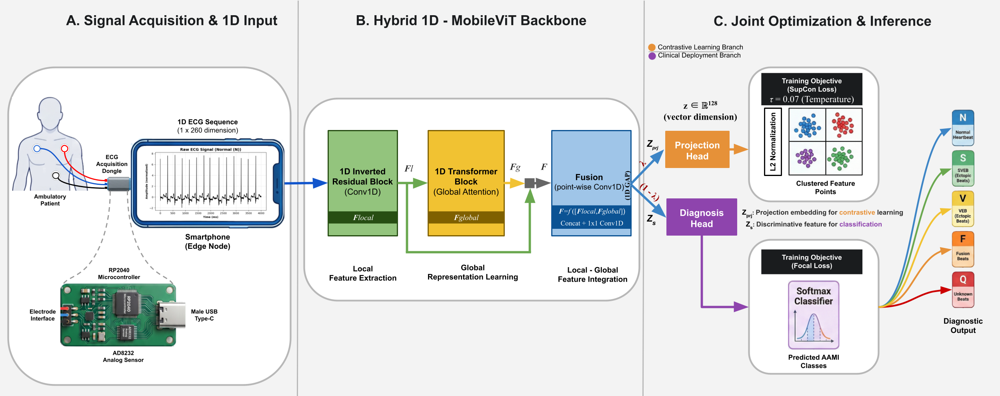

# Edge-Deployable 1D-MobileViT with Contrastive Learning for Patient-Specific ECG Classification

[](https://colab.research.google.com/drive/1_DqkyX0o-hYtzHMS4DlxvOfNseqXMYmM) 
[]()

This repository contains the official PyTorch implementation, ablation study code, and hardware profiling pipeline for the manuscript **"A Hardware-Aware 1D-MobileViT Framework for Efficient Edge-Based ECG Arrhythmia Detection: A Simulation-Based Feasibility Study"**, submitted to *IEEE JOURNAL OF BIOMEDICAL AND HEALTH INFORMATICS* (JBHI).

## 📌 Overview
Continuous ECG monitoring in ambulatory settings requires models that achieve high diagnostic performance while remaining computationally frugal. We propose a **1D-MobileViT** architecture that bypasses computationally expensive 2D time-frequency transformations (e.g., CWT), processing raw 1D ECG signals natively — combining convolutional layers for local feature extraction with self-attention for global temporal dependency modeling.

Coupled with a **Supervised Contrastive Learning (SupCon)** objective to handle clinical class imbalance, the framework is validated through a rigorous, multi-seed statistical protocol and an edge-simulation profiling approach mimicking a low-latency, offline wearable node architecture.

> **Note on scope:** As reflected in the manuscript subtitle, hardware deployability is evaluated through **simulation** (single-threaded ONNX Runtime profiling with an ARM scaling factor), not on physical ARM hardware. This distinction, and the pathway toward physical validation, is discussed in detail in the manuscript's Limitations section.

### ✨ Key Features
- **Ultra-Lightweight:** Only **~0.34M parameters** (336.86K, measured via profiling) and **~6.6M MACs**.
- **Statistically Rigorous Evaluation:** All headline results are reported as **mean ± standard deviation over 5 independent training runs** (seeds 42, 7, 123, 2024, 99), with paired significance testing in the ablation study — not a single lucky run.
- **Real-Time Edge Inference (Simulated):** Evaluated via ONNX Runtime (Opset 18, single-threaded CPU) with an estimated latency of **~1.49 ms** per heartbeat under a 2.5× ARM-scaling emulation.
- **Robust Generalization:** Achieves a mean **Accuracy of 87.80% ± 1.64** and **Weighted F1-score of 88.00% ± 1.00** under a strict, unseen patient-specific (DS1/DS2) protocol on MIT-BIH, and generalizes to the unseen INCART database (Accuracy: 88.00%, Weighted F1: 89.00%) without retraining.
- **Transparent Reproducibility Investigation:** This repository documents a real numerical-stability issue discovered in an earlier version of the SupCon loss (missing log-sum-exp stabilization + an abrupt loss-weight schedule), the diagnostic process that uncovered it, and the validated fix — see [Reproducibility & Known Issues](#-reproducibility--known-issues) below.
- **Full Ablation Study:** Code for all three compared variants (1D-ResNet18 Baseline, 1D-MobileViT without SupCon, and the full Proposed framework) is included, trained under matched, seed-controlled conditions.

## 🏗️ Architecture

The proposed architecture integrates local feature extraction via efficient 1D convolutions with global dependency modeling using lightweight attention mechanisms, jointly optimized with a Supervised Contrastive Loss (SupCon) and a class-weighted Focal Loss.

<p align="center">
  
  <br><em>Fig 1: Schematic overview of the proposed 1D-MobileViT-based framework. Panel A depicts the planned, integrated single-PCB acquisition dongle (see note below); the present simulation-based study uses a two-component setup (Raspberry Pi Pico H + AD8232 sensor).</em>
</p>

## 📊 Results Summary

| Model Variant | Accuracy (%) | Macro F1 (%) | Params (M) |
|---|---|---|---|
| Baseline (1D-ResNet18) | 87.00 ± 2.74 | 34.20 ± 2.86 | 3.80 |
| 1D-MobileViT (No SupCon) | 88.00 ± 1.22 | 34.40 ± 1.52 | 0.34 |
| **Proposed (1D-MobileViT + SupCon)** | **87.80 ± 1.64** | **34.40 ± 1.14** | **0.34** |

*Reported as mean ± std over 5 matched random seeds on the MIT-BIH DS2 (patient-specific) test set. Paired t-tests show no statistically significant difference in mean Accuracy/Macro F1 between variants (all p > 0.05); the Proposed variant's principal empirical advantage is the **lowest run-to-run variance for the clinically critical Ventricular (V) class** (F1: 72.20% ± 4.76, vs. 70.00% ± 6.96 for No-SupCon and 64.20% ± 9.01 for Baseline) — see the manuscript's Ablation Study and Discussion sections for the full statistical analysis.*

## 🛠️ Project Structure & Data
To ensure a seamless reviewer experience and immediate reproducibility, both benchmark datasets (MIT-BIH & INCART) have been pre-processed according to the AAMI EC57 standard and securely cached on Google Drive, with automatic fallback to raw PhysioNet extraction if the cache is unavailable.

- `manuscript_github_code.ipynb` — the main pipeline: data loading, 1D-MobileViT + SupCon training, internal MIT-BIH evaluation and visualizations, INCART cross-dataset validation, and ONNX-based hardware profiling.
- Ablation study variants (1D-ResNet18 Baseline and 1D-MobileViT without SupCon) share the same data pipeline and evaluation protocol as the main notebook; see the manuscript's Ablation Study section (Table 5) for the exact training configuration (identical hyperparameters, matched seeds, and — for the No-SupCon comparison — identical stabilization infrastructure including gradient clipping) used to isolate each variant's individual contribution.

## 🚀 How to Run (1-Click Execution)
> **⚠️ Note for Reviewers:**
> When executing the first cell (Module 1: Setup), Google Colab may display transient warnings or version conflict messages related to its pre-installed backend packages. Please **ignore these warnings**. They do not affect the execution of our 1D-MobileViT architecture.

The main experimental pipeline — data loading, training, internal/external validation, and hardware profiling — is encapsulated in a single, well-documented Jupyter Notebook.

1. Click the **"Open In Colab"** badge at the top of this repository.
2. Run the cells sequentially (Modules 1 → 8).
3. The notebook will automatically:
   - Download the pre-processed ECG datasets (or extract them from PhysioNet as a fallback).
   - Initialize the compact 1D-MobileViT backbone and the numerically-stabilized SupCon + Focal dual-loss objective.
   - Train using a 2-epoch warm-up followed by a **gradual, 5-epoch linear ramp-up** of the SupCon loss weight (λ: 0.0 → 0.5) — see [Reproducibility & Known Issues](#-reproducibility--known-issues) for why this replaced an earlier abrupt-switch schedule.
   - Generate publication-ready visualizations (Learning Curves, Confusion Matrix, t-SNE).
   - Perform cross-dataset evaluation on INCART with Test-Time Augmentation.
   - Simulate edge hardware latency using ONNX Runtime.

To reproduce the paper's reported statistics, re-run the notebook with `Config.SEED` set to each of `42, 7, 123, 2024, 99` (Runtime → Restart and run all for each seed) and aggregate the resulting `classification_report` outputs. Note that, as discussed below, bit-exact reproduction of any single seed's result is **not guaranteed** in cloud GPU environments such as Colab.

## 🔍 Reproducibility & Known Issues

In the interest of full transparency, and because it materially affected our reported statistics, we document a reproducibility investigation conducted during this study:

1. **Seed-specific training instability (found and fixed).** An earlier version of the SupCon loss lacked the log-sum-exp max-subtraction step used for numerical stability in the original reference implementation ([Khosla et al., 2020](https://arxiv.org/abs/2004.11362)), and switched its loss weight abruptly (rather than gradually) after the warm-up phase. Under that earlier implementation, one random seed (123) produced a severe training collapse (Accuracy: 68%) that did not occur in the Baseline or No-SupCon variants at the same seed. We diagnosed both issues, corrected them (adding max-subtraction stabilization, a gradual λ ramp-up, and gradient-norm clipping), and confirmed the fix resolves the instability. **The code in this repository reflects the corrected, stabilized implementation.**
2. **GPU-level non-determinism.** Even with correct seeding (`torch.manual_seed`, `cudnn.deterministic=True`, disabled Flash/memory-efficient attention kernels, `torch.use_deterministic_algorithms(True)`), re-running the identical configuration (seed 42) across separate Colab sessions produced three distinct results (Accuracy: 85%, 86%, 91%). We attribute this to non-deterministic low-level GPU kernel behavior and/or Colab's lack of guaranteed identical GPU hardware across sessions — a known limitation of exact reproducibility in shared cloud GPU environments, documented in PyTorch's own reproducibility notes.
3. **Practical implication.** Because single-run results can vary meaningfully for reasons outside the code's control, **all headline results in the manuscript are reported as mean ± std over 5 independent seeds**, not a single run. We recommend anyone extending this work do the same, and refer to the manuscript's Limitations section (Section 5.5) for the complete diagnostic account.

## 🖥️ Conceptual Hardware & Profiling
The present study's simulation-based evaluation uses a two-component acquisition setup: a **Raspberry Pi Pico H** microcontroller interfaced with an **AD8232** analog front-end, connected to a smartphone edge node via USB OTG. The trained model is exported to **ONNX format (Opset 18)** and executed under strict single-threaded CPU conditions, with a conservative 2.5× scaling factor applied to approximate ARM CPU behavior. All reported latency figures (**~1.49 ms/heartbeat**) are therefore simulation-based estimates and have **not** been confirmed on physical ARM hardware — this is an explicit limitation of the present study, not a final deployment claim.

A consolidated, single-PCB acquisition dongle (combining the RP2040 microcontroller and AD8232 sensor with a USB Type-C interface and onboard flash memory for offline buffering — depicted in Panel A of Fig. 1) is identified as planned future hardware work, alongside physical (non-simulated) validation on native Android hardware.

## 📚 Datasets
- **MIT-BIH Arrhythmia Database:** [https://physionet.org/content/mitdb/](https://physionet.org/content/mitdb/)
- **St. Petersburg INCART 12-lead Arrhythmia Database:** [https://physionet.org/content/incartdb/](https://physionet.org/content/incartdb/)

Both are publicly available, fully anonymized datasets from PhysioNet; no ethical approval or informed consent was required for this study.

## 📝 Citation
If you find this code or methodology useful for your research, please cite our paper:
```bibtex
@article{1DMobileViT_JBHI,
  title={Edge-Deployable 1D-MobileViT with Contrastive Learning for Patient-Specific ECG Classification},
  author={Anonymous for Review},
  journal={IEEE JOURNAL OF BIOMEDICAL AND HEALTH INFORMATICS},
  year={2026}
}
```

## 📄 License & Disclaimer
This repository is provided for research and reproducibility purposes accompanying a manuscript under peer review. The framework has not been clinically validated and is not intended for diagnostic use. See the manuscript's Limitations section for a full account of the framework's current clinical scope and constraints.
