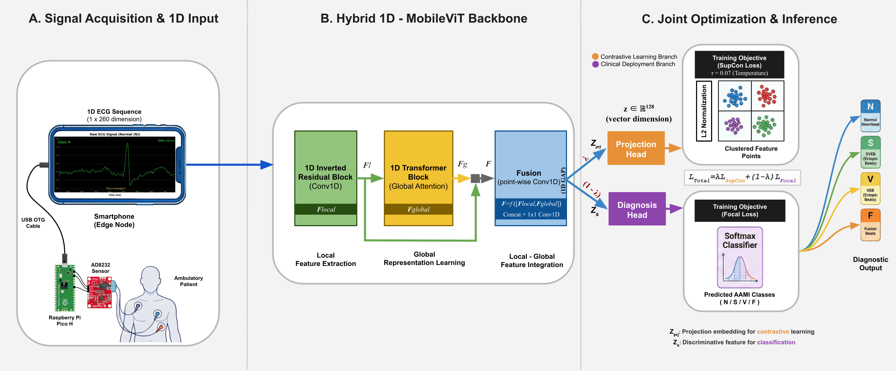

# Edge-Deployable 1D-MobileViT with Contrastive Learning for Patient-Specific ECG Classification

[]()
[]()
[]()
[]()

> **Anonymous submission to IEEE Journal of Biomedical and Health Informatics (JBHI)**  
> Full author list will be released upon acceptance.

---

<p align="center">
  
  <br>
  <em>Fig. 1: End-to-end architecture of the proposed edge-deployable ECG classification framework. (A) Signal acquisition via AD8232 + Raspberry Pi Pico H, streamed over USB OTG to the Android edge node. (B) Hybrid 1D-MobileViT backbone combining local Conv1D and global self-attention. (C) Joint optimization with SupCon and Focal Loss, producing N/S/V/F diagnostic output.</em>
</p>

---

## Overview

Continuous ambulatory ECG monitoring requires models that deliver clinical-grade accuracy under strict hardware constraints. This repository provides the official implementation of a lightweight **1D-MobileViT** architecture coupled with **Supervised Contrastive Learning (SupCon)**, validated under the rigorous AAMI EC57 inter-patient (DS1/DS2) protocol and confirmed deployable on a commercial Android smartphone.

**Key results at a glance:**

| Metric | DS2 (Internal) | INCART (Zero-Shot) |
|---|---|---|
| Accuracy | 89.78% | 92.74% |
| Macro-F1 | 0.402 | **0.502** |
| Weighted-F1 | 0.883 | 0.928 |
| VEB (V) F1 | 0.642 | 0.755 |
| Fusion (F) F1 | 0.000† | **0.127** |
| Parameters | 403,700 | 403,700 |
| ARM Latency | **4.57 ± 0.17 ms** | (same model) |

†DS2 F-class failure is a dataset-structural artifact (362/388 beats from one patient); INCART F1=0.127 confirms genuine Fusion morphology encoding.

---

## Architecture

The proposed **1D-MobileViT** operates natively on raw 1D ECG sequences, bypassing computationally expensive 2D time-frequency transforms entirely.

```
Raw ECG (1×260)
      │
      ▼
Stem Conv1D (stride 2) ──► 16×130
      │
      ▼
Local 1: MobileNetV2 (stride 2) ──► 32×65
Local 2: MobileNetV2 (stride 2) ──► 64×33
      │
      ▼
Global 1: MobileViT Block (MHSA, heads=4, dim=64) ──► 64×33
      │
      ▼
Local 3: MobileNetV2 (stride 2) ──► 128×17
      │
      ▼
Global 2: MobileViT Block (MHSA, heads=4, dim=128) ──► 128×17
      │
      ▼
Global Average Pooling ──► 128
      │
   ┌──┴──┐
   ▼     ▼
Proj   Cls
Head   Head
(SupCon) (Focal)
```

**Total: 403,700 parameters | 6.6M MACs**

---

## Optimization: Dual-Loss with Warmup

```
L_total = λ · L_SupCon + (1−λ) · L_Focal
```

- **Epochs 1–2 (Warmup):** λ = 0.0 (Focal only — prevents early representation collapse)
- **Epochs 3–7 (Ramp-up):** λ linearly increases 0.0 → 0.5
- **Epoch 8+:** λ = 0.5 (fixed)
- **Temperature:** τ = 0.07
- **Focal Loss:** γ = 2.0, class-weight-free

---

## Datasets

| Dataset | Role | Records | Beats | Hz |
|---|---|---|---|---|
| MIT-BIH DS1 | Training | 22 | ~45K | 360 |
| MIT-BIH DS2 | Internal Test (once, frozen) | 22 | 49,686 | 360 |
| INCART | Zero-Shot External Validation | 75 | 175,805 | 257→360 |

**DS2 integrity:** Evaluated exactly once after model freezing. No DS2 data was used for model selection, hyperparameter tuning, or any training decision at any stage.

**INCART resampling:** 257 Hz → 360 Hz via Fourier interpolation (`scipy.signal.resample`); R-peak indices scaled proportionally.

**AAMI superclasses:** N (Normal), S (Supraventricular), V (Ventricular), F (Fusion). Q class excluded per AAMI EC57. Paced records (102, 104, 107, 217) excluded.

---

## Ablation Study

| Model | Config | Val MacF1 | DS2 MacF1 | INCART MacF1 |
|---|---|---|---|---|
| **EXP006 (Proposed)** | MobileViT + SupCon + Warmup | 0.476 | 0.402 | **0.502** |
| EXP007-A | −SupCon (Focal only) | **0.507** | **0.462** | 0.463 |
| EXP007-B | −Warmup (SupCon from epoch 0) | 0.448 | — | — |
| EXP007-C | −Architecture (1D-CNN + SupCon) | 0.440 | — | — |

**Key finding:** SupCon consistently trades in-distribution (DS2) MacF1 for cross-dataset (INCART) MacF1 — confirmed across **15 systematic hyperparameter configurations**. This is a structural property of the SupCon objective, not a random artifact.

---

## Hyperparameter Sweep Summary (EXP008–EXP009)

| ID | λ | τ | Warmup | LR Sched | DS2 MacF1 | INCART MacF1 |
|---|---|---|---|---|---|---|
| **EXP006** | **0.5** | **0.07** | **2** | **constant** | 0.402 | **0.502** |
| EXP007-A | 0.0 | — | — | constant | 0.462 | 0.463 |
| EXP008-S2 | 0.2 | 0.07 | 2 | constant | 0.415 | 0.445 |
| EXP008-S4 | 0.3 | 0.10 | 5 | constant | 0.462 | 0.463 |
| EXP009-R2 | 0.10* | 0.07 | none | constant | 0.473 | 0.461 |
| EXP009-R4 | 0.10* | 0.10 | none | constant | 0.441 | 0.486 |

*EXP009 uses fixed α in `L = L_Focal + α·L_SupCon` (no warmup schedule).

---

## Edge Hardware Deployment

### Pipeline

```
AD8232 Analog Front-End
        │ analog ECG signal
        ▼
Raspberry Pi Pico H (RP2040)
  · 12-bit SAR ADC @ 360 Hz
  · Hardware timer interrupt
  · 16-bit little-endian packetization
  · USB CDC Serial streaming @ 360 Sa/s
        │ USB Type-C OTG
        ▼
Android Smartphone (Edge Node)
  · ONNX Runtime Android 1.19.2
  · Single-threaded CPU execution
  · Per-beat inference: 4.57 ± 0.17 ms
  · Power: ~90 mA @ 5V (bus-powered)
```

### Validated Latency

| Device | SoC | Latency | Method |
|---|---|---|---|
| Xiaomi Redmi Note 10 Pro | Snapdragon 732G (ARM Cortex-A77) | **4.57 ± 0.17 ms** | ONNX Runtime Android, n=5 runs × 1,000 inferences |

At physiological heart rates (60–100 BPM), the inter-beat interval is 600–1,000 ms. The 4.57 ms inference latency represents **less than 1%** of the available processing window, confirming strict real-time feasibility.

### Hardware Specifications

| Component | Specification |
|---|---|
| ECG Sensor | SparkFun AD8232 Analog Front-End |
| MCU | Raspberry Pi Pico H (RP2040, dual-core ARM Cortex-M0+) |
| ADC | 12-bit SAR, f_s = 360 Hz |
| Connection | USB Type-C OTG (wired, no Bluetooth/Wi-Fi) |
| Power | Bus-powered from smartphone (~90 mA @ 5V) |
| Android Runtime | ONNX Runtime Android 1.19.2 |
| ONNX Opset | 18 |

---

## Reproducibility

All experiments conducted with **fixed random seed (SEED=42)**.

| Checkpoint | SHA-256 |
|---|---|
| EXP005 (1D-CNN Baseline) | `2286e892...` |
| EXP006 (Proposed — FINAL) | `18acb7f8...` |
| EXP007-A (Focal only) | `1d9af398...` |

**DS2 was evaluated exactly once per model after complete freezing.**  
**INCART was never accessed during training, validation, or model selection.**

---

## Repository Structure

```
ECG-SupCon/
├── README.md
├── model/
│   └── mobilevit1d.py          # 1D-MobileViT architecture (EXP006)
├── export/
│   └── onnx_export.py          # ONNX export + verification script
├── checkpoints/
│   └── README.md               # Checkpoint download instructions
├── notebooks/
│   └── ECG_JBHI_EXP006_DS1_Training.ipynb  # Training pipeline
└── assets/
    └── proposed_pipeline.png   # Figure 1
```

> **Note:** Full training code and remaining experiment notebooks will be released upon paper acceptance, following institutional review.

---

## Citation

```bibtex
@article{mobilevit1d_ecg_2026,
  title   = {Edge-Deployable 1D-MobileViT with Contrastive Learning 
             for Patient-Specific ECG Classification},
  author  = {Anonymous for Review},
  journal = {IEEE Journal of Biomedical and Health Informatics},
  year    = {2026}
}
```

---

## Datasets

- **MIT-BIH Arrhythmia Database:** https://physionet.org/content/mitdb/
- **St. Petersburg INCART Database:** https://physionet.org/content/incartdb/

Both datasets are publicly available, fully anonymized, and freely accessible via PhysioNet. No ethical approval or informed consent was required for this study.

---

## License & Disclaimer

This repository is provided solely for research reproducibility purposes accompanying a manuscript under peer review. The framework has **not been clinically validated** and is **not intended for diagnostic use**. See the manuscript's Limitations section for a complete account of the framework's current scope and constraints.
